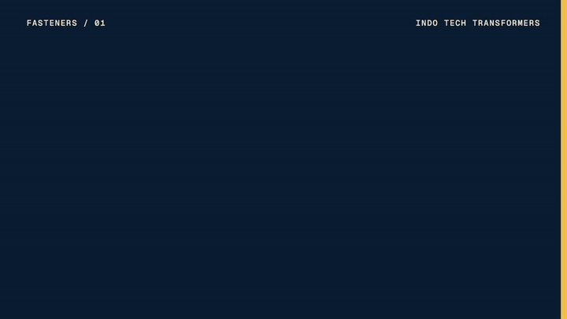

# IndoTech Hardware Automation (Fasteners)

Reads a transformer's hardware list PDF and writes the fastener schedule to Excel and PDF, with weights, so nobody has to retype bolt lists by hand.

- Drag a hardware PDF onto the window, or browse to it.
- Reads the work order, revision, customer and rating from the PDF header.
- Rounds odd bolt lengths up to the next 10 (X25 → X30, X35 → X40), so the list matches stock sizes.
- Adds a weight for each line from the weight table.
- Saves the Excel file and a PDF copy, with the prepared / checked / approved fields filled in.

## See it in 30 seconds

<a href="docs/film/fasteners.mp4">
  <picture>
    <source media="(prefers-color-scheme: dark)" srcset="docs/film/fasteners-dark.gif">
    <source media="(prefers-color-scheme: light)" srcset="docs/film/fasteners-light.gif">
    
  </picture>
</a>

<p align="center"><sub>Fasteners Automation in 30 seconds. The preview plays silently with subtitles; <a href="docs/film/fasteners.mp4">open the MP4</a> for the narrated version with music.</sub></p>

## Quick start (Windows)

```bash
git clone https://github.com/KRISH-exe-29/Fasteners-Project.git && cd Fasteners-Project
pip install pdfplumber pandas openpyxl tkinterdnd2 pywin32
python hardware_generator.py
```

Click **Select Hardware PDF**, choose the PDF, then pick an output folder. The Excel file and the PDF appear there. The PDF copy is printed through Microsoft Excel, so Excel must be installed.

## Settings

`config.json` holds the weight table path, the last output folder, the theme, and the prepared / checked / approved initials and format number. Edit it to match your PC before the first run.

## If the application fails

- Close the output Excel file if it is already open.
- Make sure the PDF has real text, not a scanned image.
- Make sure Microsoft Excel is installed.

## Weight table

Only HDG coating values are active. MAGNI, BLACK, SS and HT show N/A until their values are added to `WEIGHT_TABLE`.

To add a MAGNI rate, open `hardware_generator.py` and add a line like this under the `WEIGHT_TABLE` section:

```python
"M16X50-MAGNI": 27,
```

## Rounding rule

Odd lengths (X25, X35, X45…) are rounded up to the nearest 10 (X30, X40, X50…). The output shows the rounded size.

---

IndoTech internal software.
